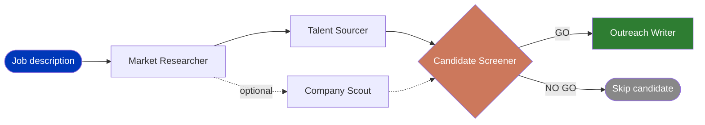

<div align="center">


# 🇮🇱 Sourcing Sabra

**Six Claude Code skills that turn a job description into a working sourcing pipeline.**

Built and used daily by a recruitment sourcing team in Israel.

[](LICENSE)
[](https://claude.com/claude-code)
[](skills)
[](#about-me)

</div>

Point Claude at a job description, get target companies, search strings, screening decisions, and outreach drafts back. No black box. Every skill is a plain markdown file you can read, change, and argue with.

## How it flows



**Pipeline Strategist** runs this whole flow end to end for a new role. Use it standalone, or run each skill on its own when you only need one step.

## The skills

| Skill | What it does |
|---|---|
| [`market-researcher`](skills/market-researcher/SKILL.md) | Maps out who's hiring for a role and who to target: companies, tiered by relevance, plus a read on how hard the hire actually is |
| [`company-scout`](skills/company-scout/SKILL.md) | Deep-dives on one specific company when a candidate's employer, or a target company, is too vague to judge fit |
| [`talent-sourcer`](skills/talent-sourcer/SKILL.md) | Turns the market research into tiered boolean search strings, tight to loose, with a title and seniority expansion reference |
| [`candidate-screener`](skills/candidate-screener/SKILL.md) | Screens a candidate profile against the role and returns a GO / NO GO with evidence, not a vibe |
| [`outreach-writer`](skills/outreach-writer/SKILL.md) | Writes a subject line and a personal note from verified facts in the candidate's profile, never a guess |
| [`pipeline-strategist`](skills/pipeline-strategist/SKILL.md) | Runs all five in sequence for a new role, start to finish |

Use them one at a time, or run `pipeline-strategist` for the full thing.

## Install

Copy the skill folders you want into your Claude Code skills directory:

```bash
git clone https://github.com/gehtalexey/sourcing-sabra.git
cp -r sourcing-sabra/skills/* ~/.claude/skills/
```

Then in Claude Code, invoke a skill directly:

```
/market-researcher path/to/job-description.txt
```

Each skill works on its own. You don't need the others installed for any single one to run.

## Why this exists

Most of what a good sourcer does is judgment, not tooling: which companies actually have the right talent, whether a profile is real seniority or an inflated title, what to say in an opening line that isn't recruiter noise. These skills write that judgment down as instructions an AI can follow consistently, instead of it living only in one recruiter's head.

They come out of a real internal sourcing pipeline used across multiple live recruiting projects, with anything specific to internal tools or client work stripped out.

## About me

I lead the technical sourcing team at Added Value, a recruitment agency for Israeli tech startups.

I'm not a developer. Before tech I studied body psychotherapy and taught yoga. I got into building tools by describing what I want to Claude Code in plain English, not by writing code by hand.

Most sourcing and outreach tools are built and priced for the US market, and they don't really fit how Israeli tech recruiting works day to day. My team builds a lot of what we actually use internally. These six skills are that method, cleaned up and shared.

[LinkedIn](https://www.linkedin.com/in/alexeygeht/)

*(add a photo here if you want one — drop it in the repo and reference it, e.g. ``)*

## License

MIT. Use it, fork it, adapt it for your own team.
