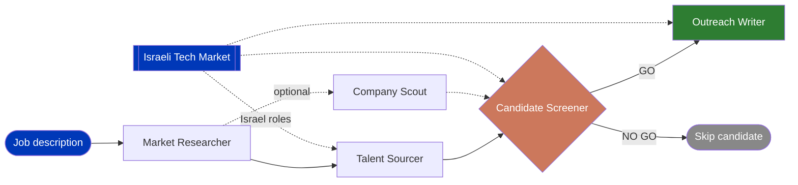

<div align="center">


# 🇮🇱 Sourcing Sabra

**Seven skills that give your sourcing agent the judgment of an Israeli tech sourcer.**

Based on the method a recruitment sourcing team in Israel uses every day.

[](LICENSE)
[](https://claude.com/claude-code)
[](skills)
[](#about-me)

</div>

Point Claude at a job description, get target companies, search strings, screening decisions, and outreach drafts back. No black box. Every skill is a plain markdown file you can read, change, and argue with.

## How it flows



**Pipeline Strategist** runs this whole flow end to end for a new role. Use it standalone, or run each skill on its own when you only need one step.

## The skills

| Skill | What it does |
|---|---|
| [`market-researcher`](skills/market-researcher/SKILL.md) | Maps out who's hiring for a role and who to target: companies, tiered by relevance, plus a read on how hard the hire actually is |
| [`company-scout`](skills/company-scout/SKILL.md) | Deep-dives on one specific company when a candidate's employer, or a target company, is too vague to judge fit |
| [`talent-sourcer`](skills/talent-sourcer/SKILL.md) | Turns the market research into tiered boolean search strings, tight to loose, with a title and seniority expansion reference |
| [`candidate-screener`](skills/candidate-screener/SKILL.md) | Screens a candidate profile against the role and returns a GO / NO GO with evidence, not a vibe |
| [`outreach-writer`](skills/outreach-writer/SKILL.md) | Writes a subject line and a personal note from verified facts in the candidate's profile, never a guess |
| [`pipeline-strategist`](skills/pipeline-strategist/SKILL.md) | Runs all five in sequence for a new role, start to finish |
| [`israeli-tech-market`](skills/israeli-tech-market/SKILL.md) | What an agent can't guess about Israel: locations on profiles, army service, universities vs. colleges, R&D centers, acquisitions, Hebrew name spellings, outreach tone |

Use them one at a time, or run `pipeline-strategist` for the full thing.

## Use them inside your agent

These are plain instruction files in the open Agent Skills format (a folder with a `SKILL.md`). If you already run a sourcing agent, feed it these files and it screens, searches and writes like a sourcer who knows the Israeli market.

| Where your agent runs | How to give it the skills |
|---|---|
| Claude Code or the Claude Agent SDK | Copy the folders into `~/.claude/skills/` (or the project's `.claude/skills/`). Claude Code loads the right skill by itself; in the Agent SDK, switch skills on in its settings first. |
| Claude (web or desktop chat) | Turn on code execution, zip one skill folder, then Customize → Skills → + Create skill → Upload a skill. |
| ChatGPT (Business, Enterprise and Edu workspaces, if the admin allows it) | Skills → Create → Upload from your computer. |
| n8n, Make, or any LLM step | Paste the `SKILL.md` text into the system prompt of the step that screens (the safe default). Or fetch it from GitHub. Pin a version you have tested (a commit link, not `main`), so an update never changes your agent's decisions without you knowing. |

A good pairing: `candidate-screener` + `israeli-tech-market` on the step that judges profiles, `outreach-writer` + `israeli-tech-market` on the step that writes the first message.

Candidate profiles are personal data. Check your company's policy and your AI tool's data settings before you send profiles to any model.

## Install (Claude Code)

Copy the skill folders you want into your Claude Code skills directory:

```bash
git clone https://github.com/gehtalexey/sourcing-sabra.git
cp -r sourcing-sabra/skills/* ~/.claude/skills/
```

Then in Claude Code, invoke a skill directly:

```
/market-researcher path/to/job-description.txt
```

Each skill works on its own. You don't need the others installed for any single one to run.

## What's new (November 2026)

Four more months of running these skills on live searches, and what we learned the hard way:

- **Search:** every round runs six angles (current title, past title, past employer, best companies with any title, keywords without the title, whole market). A market is not dry until all six have run.
- **Titles:** specific 2-4 word phrases in every spelling, plus a noise test, instead of bare words like "Engineer".
- **Screening:** calibrate on real profiles first, watch for "reject if X is not stated" rules that reject everyone, and check every GO a second time, independently.
- **Outreach:** react or ask, never recite the CV; never negative; show 3 examples before writing 50.
- **Companies:** start from the client's own list, identify companies by URL not by name.
- **Feedback loop:** every hiring-manager rejection becomes a written rule.

## Why this exists

Most of what a good sourcer does is judgment, not tooling: which companies actually have the right talent, whether a profile is real seniority or an inflated title, what to say in an opening line that isn't recruiter noise. These skills write that judgment down as instructions an AI can follow consistently, instead of it living only in one recruiter's head.

They come out of a real internal sourcing pipeline used across multiple live recruiting projects, with anything specific to internal tools or client work stripped out.

## About me

I lead the technical sourcing team at Added Value, a recruitment agency for Israeli tech startups.

I'm not a developer. Before tech I studied body psychotherapy and taught yoga. I got into building tools by describing what I want to Claude Code in plain English, not by writing code by hand.

Most sourcing and outreach tools are built and priced for the US market, and they don't really fit how Israeli tech recruiting works day to day. My team builds a lot of what we actually use internally. These seven skills are that method, cleaned up and shared.

[LinkedIn](https://www.linkedin.com/in/alexeygeht/)

## License

MIT. Use it, fork it, adapt it for your own team.
